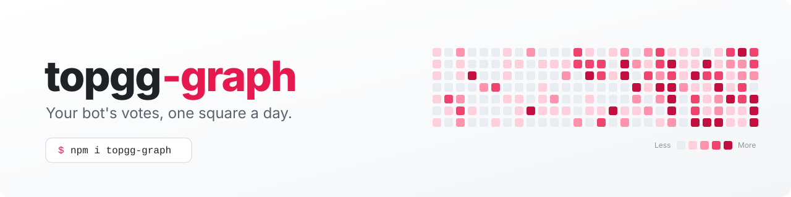

<div align="center">

<picture>
  <source media="(prefers-color-scheme: dark)" srcset="assets/banner-dark.svg">
  
</picture>

### See your bot's votes at a glance

[Install](#install) · [Quick start](#quick-start) · [API](#api-reference) · [Storage adapters](#storage-adapters)

[](https://github.com/dumbramkrishna/topgg-graph/releases)
[](https://nodejs.org)
[](LICENSE)

</div>

`@dumbramkrishna/topgg-graph` records votes as they arrive from the Top.gg webhook and stores a daily count. Those counts are rendered as a themeable SVG (or PNG) heatmap you can embed anywhere.

It supports both Top.gg webhook systems:

- **v0 (legacy)** — flat `{ bot, user, type, isWeekend }` payloads, authenticated with the `Authorization` header.
- **v1 (current)** — `{ type: "vote.create", data: { ... } }` and `webhook.test` event payloads, authenticated with `x-topgg-signature`.

## Install

The package is published to **GitHub Packages**. GitHub requires authentication even for public packages, so configure a token with `read:packages` first:

```sh
npm config set @dumbramkrishna:registry https://npm.pkg.github.com
npm login --scope=@dumbramkrishna --auth-type=legacy
npm i @dumbramkrishna/topgg-graph
```

In CI, set `NODE_AUTH_TOKEN` to a token with `read:packages` and add the scope registry to `.npmrc` (the package's own `.npmrc` already contains the scope line).

PNG output requires the optional peer dependency:

```sh
npm i @resvg/resvg-js
```

## Quick start

### Express

```ts
import express from "express";
import { TopggGraph, JsonFileAdapter } from "@dumbramkrishna/topgg-graph";

const app = express();

const graph = new TopggGraph({
  storage: new JsonFileAdapter("./votes.json"),
  webhookAuth: process.env.TOPGG_WEBHOOK_SECRET,
});

// express.raw gives the handler the bytes needed for v1 signature checks.
app.post("/webhook", express.raw({ type: "*/*" }), (req, res) => {
  void graph.webhook()(req, res);
});

// Serve the graph
app.get("/graph.svg", async (_req, res) => {
  res.setHeader("Content-Type", "image/svg+xml");
  res.send(await graph.render({ theme: "dark" }));
});

app.listen(3000);
```

### discord.js

```ts
import { Client, GatewayIntentBits, AttachmentBuilder } from "discord.js";
import http from "node:http";
import { TopggGraph, JsonFileAdapter } from "@dumbramkrishna/topgg-graph";

const graph = new TopggGraph({
  storage: new JsonFileAdapter("./votes.json"),
  webhookAuth: process.env.TOPGG_WEBHOOK_SECRET,
});

// Webhook receiver (plain node:http)
http
  .createServer(async (req, res) => {
    if (req.url === "/webhook") await graph.webhook()(req, res);
    else res.writeHead(404).end();
  })
  .listen(3000);

// Slash command handler
const client = new Client({ intents: [GatewayIntentBits.Guilds] });
client.on("interactionCreate", async (interaction) => {
  if (!interaction.isChatInputCommand() || interaction.commandName !== "votes") return;
  await interaction.deferReply();
  const png = await graph.renderPNG({ theme: "dark" });
  await interaction.editReply({ files: [new AttachmentBuilder(png, { name: "votes.png" })] });
});
client.login(process.env.DISCORD_TOKEN);
```

## Why a webhook?

Top.gg's API does not expose per-day vote history. To build an accurate daily breakdown, votes must be recorded as they arrive. `topgg-graph` verifies each incoming webhook request and writes a daily count to your chosen storage backend.

### Payload shapes

Legacy v0 payloads are flat:

```json
{
  "bot": "803190510032756736",
  "user": "160105994217586689",
  "type": "upvote",
  "isWeekend": false,
  "query": ""
}
```

v1 payloads are event envelopes:

```json
{
  "type": "vote.create",
  "data": {
    "id": "808499215864008704",
    "weight": 2,
    "created_at": "2026-02-09T00:47:14.2510149+00:00",
    "project": { "platform_id": "803190510032756736" },
    "user": { "platform_id": "160105994217586689" },
    "query": {}
  }
}
```

`webhook.test` events are acknowledged without being counted unless `recordTestVotes: true`. v1 votes are bucketed by `data.created_at` (falling back to the signed timestamp) and use `data.weight`, so double-vote weekends are handled correctly.

### Webhook options

| Option                      | Type                                 | Default   | Description                          |
| --------------------------- | ------------------------------------ | --------- | ------------------------------------ |
| `auth`                      | `string`                             | —         | Webhook secret                       |
| `storage`                   | `StorageAdapter`                     | —         | Where votes are stored               |
| `recordTestVotes`           | `boolean`                            | `false`   | Store test votes too                 |
| `onVote`                    | `(payload) => void \| Promise<void>` | —         | Called after a valid vote            |
| `signatureToleranceSeconds` | `number`                             | `300`     | Allowed clock skew for v1 timestamps |
| `maxBodyBytes`              | `number`                             | `1048576` | Maximum request body size            |
| `dedupeWindowSeconds`       | `number`                             | `1200`    | In-memory duplicate/retry window     |

The handler returns `204` for accepted votes, `400` for bad payloads/JSON, `401` for failed authentication, `405` for non-POST requests, `413` for oversized bodies, and `500` for storage failures. Fastify's `reply` object and `node:http`'s `ServerResponse` are both supported.

> Deduplication is in memory and covers Top.gg's retry schedule on a per-process basis. For multi-process deployments, deduplicate v1 event IDs in your storage adapter as well.

## Exports

| Name                            | What it does                                                        |
| ------------------------------- | ------------------------------------------------------------------- |
| `TopggGraph`                    | Convenience class — wraps storage, webhook, and render              |
| `createWebhookHandler(opts)`    | Returns a `(req, res) => Promise<void>` handler                     |
| `renderSVG(counts, opts?)`      | Render counts to an SVG string                                      |
| `renderPNG(svg)`                | Render an SVG string to a PNG `Buffer` (requires `@resvg/resvg-js`) |
| `getRenderWindow(today, weeks)` | Inclusive grid date range (Sunday → Saturday)                       |
| `MemoryAdapter`                 | In-memory storage (resets on restart)                               |
| `JsonFileAdapter`               | Atomic JSON file storage                                            |
| `utcDateString(ts?)`            | Current UTC date as `YYYY-MM-DD`                                    |
| `parseDateString(date)`         | Parse/validate a UTC date string                                    |
| `nextDateString(date)`          | Advance a UTC date string by one day                                |
| `dateRange(from, to)`           | All `YYYY-MM-DD` strings in an inclusive range                      |
| `colorLevel(count, nonzero)`    | Map a count to a 0–5 color level                                    |
| `sortedNonzero(counts)`         | Sorted nonzero counts used for color thresholds                     |
| `StorageAdapter`                | Interface for custom storage backends                               |
| `RenderOptions`                 | Options type for `renderSVG`                                        |
| `Theme`                         | `"light" \| "dark" \| CustomTheme`                                  |
| `TopggVotePayload`              | Normalized webhook payload                                          |
| `WebhookHandler`                | Handler function type                                               |

## Storage adapters

### Interface

```ts
interface StorageAdapter {
  increment(date: string, by?: number): Promise<void>;
  getRange(from: string, to: string): Promise<Record<string, number>>;
}
```

All dates are `YYYY-MM-DD` strings in UTC. `JsonFileAdapter` creates missing parent directories and recovers its write queue after a transient failure.

### Built-ins

| Adapter                           | When to use                                              |
| --------------------------------- | -------------------------------------------------------- |
| `MemoryAdapter`                   | Development, testing, or stateless environments          |
| `JsonFileAdapter("./votes.json")` | Single-process bots that want zero external dependencies |

### Custom adapter (SQLite example)

See [`examples/custom-sqlite-adapter.ts`](examples/custom-sqlite-adapter.ts) for a full `better-sqlite3` implementation.

```ts
import { TopggGraph, type StorageAdapter } from "@dumbramkrishna/topgg-graph";
import { SqliteAdapter } from "./my-sqlite-adapter.js";

const graph = new TopggGraph({
  storage: new SqliteAdapter("./votes.db"),
  webhookAuth: process.env.TOPGG_WEBHOOK_SECRET,
});
```

## Theming

### Built-in themes

| Theme     | Background | Accent    |
| --------- | ---------- | --------- |
| `"light"` | `#ffffff`  | `#ff3366` |
| `"dark"`  | `#0d1117`  | `#ff3366` |

### Custom theme

```ts
import { renderSVG } from "@dumbramkrishna/topgg-graph";

const svg = renderSVG(counts, {
  theme: {
    background: "#1a1a2e",
    text: "#eaeaea",
    empty: "#2a2a3e", // optional empty-cell color
    levels: ["#aaaaff", "#8888ff", "#6666ff", "#4444ff", "#2222ff"],
  },
});
```

`levels` is an array of exactly 5 colors from least active (index 0) to most active (index 4). Counts outside the visible week window are ignored when computing the title total and color thresholds.

## API reference

### `new TopggGraph(options?)`

| Option        | Type             | Description                  |
| ------------- | ---------------- | ---------------------------- |
| `storage`     | `StorageAdapter` | Defaults to `MemoryAdapter`  |
| `webhookAuth` | `string`         | Required to call `webhook()` |

#### Methods

| Method                  | Returns                           | Description                                               |
| ----------------------- | --------------------------------- | --------------------------------------------------------- |
| `webhook(opts?)`        | `(req, res) => Promise<void>`     | Webhook handler                                           |
| `record(date?, by?)`    | `Promise<void>`                   | Manually add votes for a validated UTC date               |
| `getCounts(from?, to?)` | `Promise<Record<string, number>>` | Raw daily counts; `from` defaults to 364 days before `to` |
| `render(opts?)`         | `Promise<string>`                 | SVG string                                                |
| `renderPNG(opts?)`      | `Promise<Buffer>`                 | PNG Buffer                                                |

### `renderSVG(counts, options?)`

| Option     | Type     | Default           | Description                                                        |
| ---------- | -------- | ----------------- | ------------------------------------------------------------------ |
| `weeks`    | `number` | `52`              | Number of columns (positive integer)                               |
| `cellSize` | `number` | `11`              | Cell size in px                                                    |
| `gap`      | `number` | `2`               | Gap between cells in px                                            |
| `radius`   | `number` | `2`               | Cell corner radius in px                                           |
| `theme`    | `Theme`  | `"light"`         | `"light"`, `"dark"`, or custom object                              |
| `title`    | `string` | `"Vote activity"` | Title above the grid                                               |
| `today`    | `string` | Today UTC         | Override the grid end date (also controls the fetched data window) |

---

[Contributing](CONTRIBUTING.md) · Built by [dumbramkrishna](https://github.com/dumbramkrishna) · [MIT](LICENSE)
